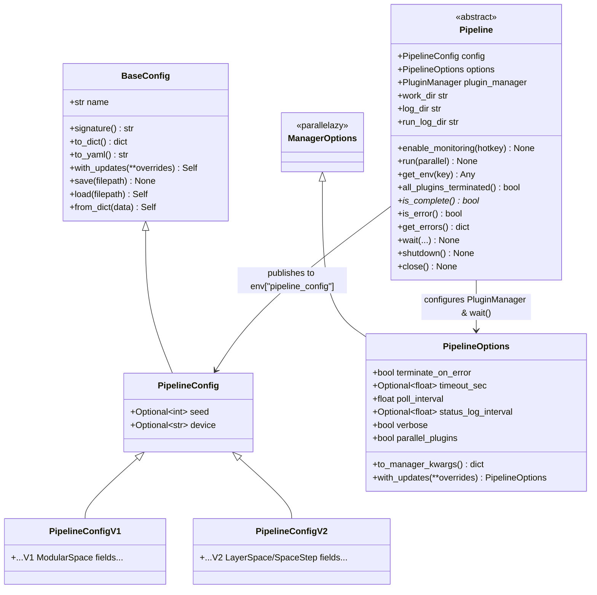

# PositronixLab Pipeline System

The `positronixlab.pipeline` package provides two layers:

1. **Composable Configuration (`BaseConfig`, `PipelineConfig`, `PipelineConfigV1`, `PipelineConfigV2`)** — flat, typed dataclasses with deterministic hashing, immutable updates, and JSON/YAML persistence.
2. **Multiprocess Execution Orchestration (`Pipeline`, `PipelineOptions`)** — a generic abstract base class wrapping `parallelazy.PluginManager` to manage plugin lifecycles, shared environment state, polling/timeouts, monitoring, and error collection.

---

## Architecture



### Separation of Concerns

- **`config` (`PipelineConfig`)** holds *experiment/model hyperparameters* and is published into the `parallelazy` shared environment under the key `"pipeline_config"` so every spawned plugin worker receives the exact same configuration.
- **`options` (`PipelineOptions`)** holds *runtime execution controls* (directories, logging, polling interval, error termination, timeout, parallel startup) and stays on the host process to configure `PluginManager` and `Pipeline.wait()`.

---

## Module Layout

| File | Exports | Purpose |
|---|---|---|
| `positronixlab/pipeline/__init__.py` | `BaseConfig` (eager); `Pipeline`, `PipelineConfig`, `PipelineOptions`, `PipelineConfigV1`, `PipelineConfigV2` (lazy) | Package entry point using PEP 562 `__getattr__` so importing `BaseConfig` avoids loading `parallelazy`. |
| `positronixlab/pipeline/config.py` | `BaseConfig` | Framework-independent dataclass base used by all composable domain config mixins (`DataConfig`, `TrainConfig`, `MetaModelConfig`, `LayerSpaceConfig`, `PipelineConfig`). |
| `positronixlab/pipeline/pipeline_config.py` | `PipelineOptions`, `PipelineConfig` | `ManagerOptions` subclass for runtime controls and minimal `PipelineConfig` base (`seed`, `device`). |
| `positronixlab/pipeline/pipeline.py` | `Pipeline` | Generic ABC wrapping `parallelazy.PluginManager`. Subclassed by `positronixlab.nas.trial_pipeline.TrialPipeline` and concrete pipelines in `AtlasCompose`. |
| `positronixlab/pipeline/pipeline_config_v1.py` | `PipelineConfigV1` | Flat monolithic config for `ModularSpace` (V1). |
| `positronixlab/pipeline/pipeline_config_v2.py` | `PipelineConfigV2` | Flat monolithic config for `LayerSpace` + `SpaceStep` (V2). |

---

## API Reference

### `BaseConfig` (`config.py`)

Minimal dataclass base with `name: str = "default_config"`.

| Method | Behavior |
|---|---|
| `signature() -> str` | Deterministic MD5 hex digest over `json.dumps(self.to_dict(), sort_keys=True, default=str)`. |
| `to_dict() -> Dict[str, Any]` | Deep dictionary conversion via `dataclasses.asdict(self)`. |
| `to_yaml() -> str` | YAML string via `yaml.dump(self.to_dict(), sort_keys=False)`. |
| `with_updates(**overrides) -> Self` | Returns a new instance via `dataclasses.replace()`, silently ignoring keys not defined on the dataclass. Never mutates `self`. |
| `save(filepath: str) -> None` | Creates parent directories as needed; writes JSON if `filepath.endswith(".json")`, otherwise YAML. |
| `load(filepath: str) -> Self` | Reads JSON (`.json`) or YAML (`yaml.safe_load`) and constructs via `cls.from_dict(data or {})`. |
| `from_dict(data: Dict[str, Any]) -> Self` | Filters out unknown keys, preserves `None`, and performs best-effort primitive coercion (`bool`, `int`, `float`, `str`). |

### `PipelineOptions` (`pipeline_config.py`)

Extends `parallelazy.plugin_data.ManagerOptions` with pipeline-level controls:

| Field | Default | Description |
|---|---|---|
| `terminate_on_error` | `True` | If `True`, `wait()` calls `shutdown()` and raises `RuntimeError` when a plugin enters `"error"`. |
| `timeout_sec` | `None` | Maximum wall-clock seconds for `wait()`. `None` waits indefinitely. |
| `poll_interval` | `0.25` | Sleep duration (seconds) between `wait()` polls. |
| `status_log_interval` | `None` | Periodic status logging interval (seconds). `None` disables periodic snapshots. |
| `verbose` | `False` | When `True`, `_log_status_snapshot()` logs all plugins; when `False`, only plugins with problems. |
| `parallel_plugins` | `True` | Default `parallel` argument for `PluginManager.start_all_plugins()`. |

Helper methods:
- `to_manager_kwargs() -> Dict[str, Any]` — returns only the fields defined on `ManagerOptions` for passing to `PluginManager(**kwargs)`.
- `with_updates(**overrides) -> PipelineOptions` — returns a new `PipelineOptions` with valid overrides applied.

### `Pipeline` (`pipeline.py`)

Abstract base class wrapping `parallelazy.PluginManager`.

**Lifecycle flow:**
```
__init__(config, options)
   ├─ creates PluginManager(**options.to_manager_kwargs())
   ├─ sets plugin_manager.worker_pydebug = is_debugpy_attached()
   └─ publishes config to env["pipeline_config"]
        │
        ▼
  (subclass loads plugins)
        │
        ▼
  run(parallel=None)  ──► plugin_manager.start_all_plugins(...)
        │
        ▼
  wait(...)           ──► polls is_error(), is_complete(), timeout
        │
        ▼
  shutdown() / close() (idempotent; also invoked by __exit__)
```

**Abstract method:**
- `is_complete(self) -> bool` — subclasses define completion criteria (e.g., checking a shared env flag or `all_plugins_terminated()`).

**Key methods & properties:**
- `work_dir`, `log_dir`, `run_log_dir` — forwarded from `self.plugin_manager`.
- `enable_monitoring(hotkey="m")` — enables `parallelazy` runtime monitoring and optional report hotkey.
- `get_env(key=None)` — reads a single key or the entire shared environment dict.
- `all_plugins_terminated()` — `True` iff at least one plugin is loaded and none have `process_alive == True`.
- `is_error()` — `True` if any plugin's `worker_status.state == "error"`.
- `get_errors()` — returns `{plugin_id: [error_msgs]}` preferring `worker_status.errors` and falling back to `plugin_errors(plugin_id)` when alive.
- `shutdown()` / `close()` — idempotent teardown; `Pipeline` supports `with MyPipeline(...) as p:`.

---

## Known Limitations

- `pipeline_config.py` imports `parallelazy.plugin_data.ManagerOptions` at module level, so importing `PipelineConfig` (or `V1`/`V2`) currently requires `parallelazy` to be importable. Import `BaseConfig` directly from `positronixlab.pipeline` (or `positronixlab.pipeline.config`) for `parallelazy`-free code.
- `BaseConfig.from_dict()` string-matches `"Optional[T]"` annotations; subclasses without `from __future__ import annotations` (including `PipelineConfigV2`) skip coercion for `Optional[...]` fields.
- See [`analysis.md`](file:///home/cesare/Projects/PositronixLab/positronixlab/pipeline/analysis.md) for the full list of known defects and refactor recommendations.
