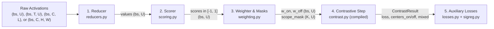

# SpaceMath System Architecture

`positronixlab.spacemath` implements the mathematical primitives for mapping neural network **Computation Units (CUs)** (neurons, channels, or clusters) into a decoupled embedding space where co-activating units attract and anti-correlating units repel.

For the conceptual intuition behind the pull/push dynamics, see [PARKING LOT PROBLEM.md](PARKING%20LOT%20PROBLEM.md).

---

## 1. Pipeline Overview

The v2 primitive architecture splits a single embedding-space update step into five composable, stateless stages:

All stages are registry-backed so experiment configurations (e.g., `PipelineConfig` / Ax NAS) can select primitives by string name.

---

## 2. Module Breakdown

### 2.1 Space Geometry (`space_type.py`)

`SpaceType` defines the two supported embedding geometries:

| Geometry | Normalization (`space_normalize`) | Distance (`distance_elementwise` / `distance_pairwise`) | SIGReg Prep (`space_sigreg_prepare`) |
| :--- | :--- | :--- | :--- |
| `SpaceType.COSINE` (`"cosine"`) | $x / \|x\|_2$ (unit hypersphere $S^{D-1}$) | $1 - \hat{x} \cdot \hat{y} \in [0, 2]$ | $\sqrt{D} \cdot (x / \|x\|_2)$ so $\mathrm{Cov} \approx I_D$ |
| `SpaceType.EUCLIDEAN` (`"euclidean"`) | Identity $x$ | $\|x - y\|_2 \ge 0$ | Identity $x$ |

- `SpaceType.normalize_name(name)` canonicalizes aliases (e.g., `"cos"` -> `"cosine"`, `"l2"` / `"euclid"` -> `"euclidean"`).
- `distance_pairwise(x, y)` supports 2D `(M, D) x (U, D) -> (M, U)`, broadcast 3D `(bs, K, D) x (U, D) -> (bs, K, U)`, and batched 3D `(bs, K, D) x (bs, U, D) -> (bs, K, U)`.

### 2.2 Architecture Reducers (`reducers.py`)

Reducers collapse architecture-specific activations into per-unit scalar summaries `(bs, U)`:

| Registry Key (`REDUCERS`) | Function | Input Shape | Behavior |
| :--- | :--- | :--- | :--- |
| `"linear"` | `reduce_linear` | `(bs, U)`, `(bs, T, U)`, or `(bs, ...)` | Identity for 2D; `mean(dim=1)` for 3D; flattens trailing dims for 4D+ |
| `"conv_locality"` | `reduce_conv_locality` | `(bs, C)`, `(bs, C, L)`, or `(bs, C, H, W)` | Pass-through for 2D; L2 over `dim=2` for 3D; blend of per-channel L2 norm and local max-pool concentration for 4D |
| `"conv_l2"` | `reduce_conv_l2` | `(bs, C, ...)` | Per-channel spatial L2 norm |
| `"conv_mean_abs"` | `reduce_conv_mean_abs` | `(bs, C, ...)` | Per-channel spatial mean of `|x|` |
| `"conv_max"` | `reduce_conv_max` | `(bs, C, ...)` | Per-channel spatial maximum |
| `"seq_mean"` | `reduce_seq_mean` | `(bs, T, U)` | Mean over sequence dimension (`dim=1`) |
| `"seq_max"` | `reduce_seq_max` | `(bs, T, U)` | Max over sequence dimension (`dim=1`) |
| `"seq_cls"` | `reduce_seq_cls` | `(bs, T, U)` | First / CLS token slice (`activations[:, 0, :]`) |
| `"seq_energy"` | `reduce_seq_energy` | `(bs, T, U)` | L2 norm over sequence dimension (`dim=1`) |

`DEFAULT_REDUCER_BY_LAYER` maps `"linear" -> "linear"`, `"conv" / "conv2d" -> "conv_locality"`, `"conv1d" -> "conv_l2"`, and `"rnn" / "lstm" / "transformer" -> "seq_mean"`.

### 2.3 Activation Scoring (`scoring.py`)

`activations_to_scores()` orchestrates optional activation application, reduction, and normalization into standardized `[-1, 1]` unit scores `(bs, U)`:

| Registry Key (`SCORERS`) | Function | Thresholding Rule |
| :--- | :--- | :--- |
| `"quantile"` | `score_quantile` | Per-sample `torch.quantile(values, active_q, interpolation="higher")` |
| `"top_k"` | `score_top_k` | Fast per-sample `torch.topk` selecting roughly the top `(1 - active_q)` fraction |
| `"sign_preserving_row"` | `score_sign_preserving_row` | Scales positive/negative entries independently per row around `0.0` |
| `"sign_preserving_batch"` | `score_sign_preserving_batch` | Scales positive/negative entries independently across the whole batch around `0.0` |
| `"softmax"` | `score_softmax` | Argmax unit(s) -> `+1.0`, all others -> `-1.0` |

> [!NOTE]
> If `activation_fn` is an `nn.Softmax` instance, `activations_to_scores` forces `score_method="softmax"`.

### 2.4 Weighting, Running Stats & Scope Masks (`weighting.py`)

- **Splitting**: `split_active_group(scores, threshold=0.0)` returns boolean `(idxs_on, idxs_off)` masks.
- **Running stats**: `stats_update_(stats, scores)` updates an in-place `(U, 4)` buffer tracking `[count_on, count_off, sum_pos_scores, sum_neg_mag]`. `stats_activation_frequency(stats)` returns per-unit activation rate in `[0, 1]`.
- **Weighters (`WEIGHTERS`)**:
  - `"raw"` (`weight_raw`): magnitude distance from `threshold`.
  - `"inv_freq"` (`weight_inv_freq`): IDF-like reweighting $w_{\text{on}} \cdot \frac{\text{freq}^{-\alpha}}{\overline{\text{freq}^{-\alpha}}}$ so always-on hub neurons do not dominate centers.
  - `"uniform"` (`weight_uniform`): binary `1.0` / `0.0` weights ignoring score magnitude.
- **Scope masks**:
  - `mask_global_scope(U, device, dtype, unit_mask=None)` -> `(1, U)` mask (optionally masking out inactive slots, e.g., in `ModularOverSpace`).
  - `mask_cluster_membership(labels, num_units, device, dtype, unit_mask=None)` -> `(K, U)` one-hot cluster mask excluding negative noise labels (`-1`); returns `None` when fewer than 2 clusters exist.

### 2.5 Contrastive Steps (`contrast.py`)

Every contrastive function takes `(positions, w_on, w_off, scope_mask, ...)` and returns a `ContrastResult(NamedTuple)`:

- `loss`: scalar total contrastive loss
- `loss_on`: scalar active attraction term (or total CE)
- `loss_off`: scalar inactive repulsion term (`0` for CE)
- `centers_on` / `centers_off`: `(bs, K, D)` weighted centroids per sample & scope
- `mixed`: `(bs, K)` binary indicator (`1.0` where a scope has both active and inactive mass)

| Registry Key (`CONTRASTS`) | Formulation |
| :--- | :--- |
| `"distance_log"` | $w_{\text{on}} \log(1 + \bar{d}_{\text{on}}) - w_{\text{off}} \log(1 + \bar{d}_{\text{off}})$ |
| `"distance_linear"` | $w_{\text{on}} \bar{d}_{\text{on}} - w_{\text{off}} \bar{d}_{\text{off}}$ |
| `"softmax_ce"` | Temperature-scaled ($\tau$) cross-entropy pulling active units toward `centers_on` within each scope |

The inner cores (`_distance_contrast_core`, `_softmax_ce_contrast_core`) are decorated with `@common.compile` (`torch.compile(mode="default")`) and keep all tensor shapes static `(bs, K, U)`.

### 2.6 Auxiliary Losses & SIGReg (`losses.py`, `sigreg.py`)

| Registry Key (`LOSSES`) | Function | Purpose |
| :--- | :--- | :--- |
| `"centers"` | `loss_centers_repulsion` | Negative mean distance between `centers_on` and `centers_off` (symmetry breaking) |
| `"batch"` | `loss_batch_repulsion` | Negative mean pairwise distance across active batch centers (anti-collapse) |
| `"sigreg"` | `loss_sigreg` | Isotropic Gaussian regularization (SIGReg) on `(M, D)` vectors |
| `"sigreg_centers"` | `loss_sigreg_centers` | Dynamic-shape SIGReg applied only to `mixed > 0` centers (kept eager outside `torch.compile`) |
| `"alignment"` | `loss_layer_alignment` | Pulls per-layer active centers toward their cross-layer mean |

`sigreg.py` provides two isotropic Gaussianity estimators:
- `sigreg_weak(pos, sketch_dim=64)`: Frobenius distance $\|\widehat{\mathrm{Cov}} - I_D\|_F$ (with optional random Gaussian projection when $D > \text{sketch\_dim}$).
- `sigreg_strong(pos, sketch_dim=64)`: Sliced characteristic-function distance to $\mathcal{N}(0, I_D)$ integrated over $t \in [-5, 5]$ via trapezoidal quadrature.

### 2.7 Shared Utilities (`common.py`) & Legacy API (`spacemath.py`)

- `common.py` provides `zclamp`/`zclamp_`, `spow`/`spow_` (also monkey-patched onto `torch.Tensor`), module predicates (`is_linear`, `is_conv`, `is_layer`, `is_activation`), `torch.compile` decorators (`compile`, `staticmethod_compile`, `classmethod_compile`), and `clear_torch_compile_cache`. Importing `common.py` sets `torch.set_float32_matmul_precision('high')`.
- `spacemath.py` retains legacy v1 `SpaceMath`, `LayerType`, and `ActivationType` for backward compatibility with `ModularSpace`, `ModularObserver`, and `tasks/compositionality`. New code should prefer the v2 primitives.

---

## 3. Known Caveats

See [`reports/spacemath_analysis.md`](file:///home/cesare/Projects/PositronixLab/reports/spacemath_analysis.md) for the full defect audit. Key operational notes:
- `contrast_*` functions trigger `torch.compile` on first call; in read-only-home environments, set `TRITON_CACHE_DIR` and `TORCHINDUCTOR_CACHE_DIR` to a writable directory (e.g., `/tmp`).
- `score_normalize_by_threshold` currently assumes `values >= threshold` are non-negative; for all-negative pre-activation rows, prefer `score_sign_preserving_row` or apply a non-negative activation (e.g., `nn.ReLU`) first.
- Keep `loss_sigreg_centers` outside compiled regions because `centers[mixed > 0]` has data-dependent shape.
