# SOTA Integration Architecture (`libs/` → `positronixlab`)

> **Goal:** Integrate the three reference repositories under `libs/` — **Csordás et al.** (`are_neural_nets_modular`), **Lepori et al.** (`Compositional_Subnetworks`), and **Lepori et al.** (`NeuroSurgeon`) — into `positronixlab` via clean, idiomatic, decoupled APIs so **PositronixLab's Atlas method** can be benchmarked apples-to-apples against state-of-the-art differentiable weight/neuron masking on identical models, datasets, and evaluation protocols.

---

## 1. Inventory & Integration Strategy for `libs/`

| Reference Repo (`libs/`) | Paper / Role | Key Assets to Reuse | What **NOT** to Import Directly | Integration Pattern |
| :--- | :--- | :--- | :--- | :--- |
| **`libs/NeuroSurgeon`** (`NeuroSurgeon==0.1.0`, editable in `.venv`) | Lepori et al. (2023/24) — clean PyTorch subnetwork library | `CircuitModel`, `CircuitConfig`, `ContSparse*`, `HardConcrete*`, `MagPrune*`, 5 ablation modes, `mask_unit={"weight","neuron"}`, `Visualizer` | Direct `CircuitModel` calls on raw non-HF models (requires `return_dict=True`, kwargs-only `__call__`, `.loss` attribute) | **Direct optional dependency** wrapped behind a thin `NeuroSurgeonAdapter` + `HFForwardShim` |
| **`libs/are_neural_nets_modular`** | Csordás et al. (ICLR 2021) — original Gumbel-Sigmoid weight masks | Datasets (`TupleArithmetic`, `AddMul`, `SCAN`, `DeepmindMath`, `PermutedMNIST`, `CIFAR-10` class removal), model specs (MLP/LSTM/Conv/ResNet110/Transformer), Gumbel-Sigmoid STE + logit penalty math, evaluation protocols (IoU stability, mask sharing, half-mask control, inverse lesioning) | PyTorch 1.6–1.13 internals (`module._parameters` hijacking, `_flat_weights`, `_broadcast_coalesced_reshape`, custom `MaskedModule` layers, W&B sweep runner) | **Re-implement / adapt cleanly** into native `positronixlab` `DataProvider`s, standard PyTorch models, and `tasks/benchmarks` |
| **`libs/Compositional_Subnetworks`** | Lepori et al. (NeurIPS 2023) — structural compositionality in Vision & Language | 4-way Odd-One-Out (OOO) formulation, **18 CVR compositional tasks** (`103–120`: Inside+Contact, Inside+Count, Contact+Count), **20 SynEval syntactic OOO tasks** (`0–19`), cosine-similarity OOO head, ResNet50-InstanceNorm / ViT / BERT-small setups, compositional ablation matrix | **Local fork of HuggingFace `transformers`** with `L0Linear` spliced in; PyTorch Lightning training harness | **Import data-generation / dataset logic** into `DataProvider`s; use **upstream `transformers`/`torchvision` + `NeuroSurgeon`** for masking |

### Core Design Principle: One Base Model, Multiple Discovery Methods, One Evaluation Suite

```mermaid
flowchart LR
    subgraph Data["1. positronixlab.dataprovider"]
        D1["TupleArithmetic / AddMul"]
        D2["SCAN / DeepMind Math"]
        D3["CVR OOO (103-120)"]
        D4["SynEval OOO (0-19)"]
        D5["CIFAR-10 / PermutedMNIST"]
    end

    subgraph Models["2. Standard PyTorch nn.Module (metamodel / sota_models)"]
        M1["MLP / LSTM / EncDec"]
        M2["Conv / ResNet50-IN / ResNet110"]
        M3["ViT / BERT-small / Transformer"]
    end

    subgraph Discovery["3. Unified MaskDiscoverer API (tasks/discovery)"]
        A["AtlasDiscoverer\n(ModularObserver + LayerSpace + KMeans)"]
        B["NeuroSurgeonDiscoverer\n(ContSparse / HardConcrete / MagPrune)"]
        C["CsordasGumbelDiscoverer\n(Gumbel-Sigmoid STE + Logit Penalty)"]
        D["Random / Magnitude Controls"]
    end

    subgraph Contract["4. Canonical SubnetworkMask Contract"]
        SM["SubnetworkMask\n(dotted keys, unit|weight, set algebra, I/O)"]
    end

    subgraph Eval["5. Unified Benchmark & Ablation Engine (tasks/benchmarks)"]
        E1["Sufficiency & Necessity\n(zero / random / complement ablate)"]
        E2["Compositional Matrix\n(Lepori OOO ablate_A / ablate_B)"]
        E3["Structural & Alignment\n(Csordas IoU, sharing, half-mask,\nAtlas vs WeightMask overlap)"]
    end

    Data --> Models
    Models --> Discovery
    Discovery --> Contract
    Contract --> Eval
```



---

## 2. The Canonical `SubnetworkMask` Contract (Fixing `tasks/compositionality`)

In our codebase audit (`positronixlab/tasks/analysis.md`), we found that `AtlasCheck.extract_weightmasks()` produces dotted keys (`"net.0"`) with 1D bool tensors `(out_features,)`, while `WeightmaskCheck` produces underscored keys (`"net_0"`) with 2D float tensors `(out_features, in_features)`, and `StaticMaskApplier` breaks when given Atlas masks.

Introducing a single canonical data structure under `positronixlab/tasks/masks.py` solves this once for **Atlas**, **Csordás**, and **Lepori/NeuroSurgeon**:

```python
@dataclass(frozen=True)
class SubnetworkMask:
    """Canonical representation of a discovered subnetwork (unit- or weight-level)."""
    name: str                                  # e.g., "task_inside", "class_3", "atlas_cluster_2"
    granularity: Literal["unit", "weight"]     # "unit": (out_units,), "weight": (*weight.shape)
    masks: dict[str, torch.Tensor]             # canonical dotted module names -> bool tensor
    scores: dict[str, torch.Tensor] | None = None  # optional continuous logits / attribution scores
    metadata: dict[str, Any] = field(default_factory=dict)  # method, seed, l0, l0_max, layer_types

    # --- Projection & Compatibility ---
    def to_weight_mask(self, model: nn.Module) -> "SubnetworkMask":
        """Broadcasts 1D unit masks (out_features,) or (out_channels,) to exact weight shapes:
        - Linear: (out, 1) -> (out, in)
        - Conv2d: (out, 1, 1, 1) -> (out, in, kh, kw)
        - Conv1d: (out, 1, 1) -> (out, in, k)
        - GPTConv1D: (1, nf) -> (nx, nf)
        """

    def to_unit_mask(self, threshold: float = 0.0) -> "SubnetworkMask":
        """Projects a weight mask to unit-level (unit active iff active_weight_frac > threshold)."""

    # --- Set Algebra (missing in NeuroSurgeon!) ---
    def __and__(self, other: "SubnetworkMask") -> "SubnetworkMask": ...   # intersection
    def __or__(self, other: "SubnetworkMask") -> "SubnetworkMask": ...    # union
    def __sub__(self, other: "SubnetworkMask") -> "SubnetworkMask": ...   # difference (self & ~other)
    def invert(self) -> "SubnetworkMask": ...                             # ~self (for lesioning)

    # --- Structural Metrics (Csordas & Lepori) ---
    def l0(self) -> int: ...
    def max_l0(self) -> int: ...
    def sparsity(self) -> float: ...          # 1.0 - l0 / max_l0 (fixes WeightMasksMetrics bug!)
    def iou(self, other: "SubnetworkMask") -> float: ...
    def per_layer_iou(self, other: "SubnetworkMask") -> dict[str, float]: ...
    def overlap_fraction(self, other: "SubnetworkMask") -> float: ...     # |self & other| / |self|

    # --- Serialization ---
    def save(self, path: str | Path) -> None: ...
    @classmethod
    def load(cls, path: str | Path) -> "SubnetworkMask": ...
```

### Why this contract is critical for Atlas vs. Weight Masks
- **Unit-to-weight projection (`to_weight_mask`)** lets an **Atlas unit mask** be evaluated through the **exact same `MaskApplier` and ablation modes** (`zero_ablate`, `random_ablate`, `randomly_sampled`, `complement_sampled`) as a NeuroSurgeon or Csordás weight mask.
- **Weight-to-unit projection (`to_unit_mask`)** lets you directly measure **Atlas-vs-WeightMask alignment** (IoU, precision, recall, F1) at both unit granularity and weight granularity!
- **Canonical dotted keys** (`dict(model.named_modules())`) eliminate `"net.0"` vs `"net_0"` mismatches everywhere.

---

## 3. Graceful API Integration by Layer

### 3.1 `positronixlab.dataprovider` — SOTA Benchmarks & Task Families

Five stub files already exist in `positronixlab/dataprovider/` (`scan_dataprovider.py`, `math_dataprovider.py`, `oddoneout_dataprovider.py`, `cvr_oddoneout_dataprovider.py`, `syneval_oddoneout_dataprovider.py`), currently loading dummy `.pt` tensors. We should evolve them into real providers plus a **compositional task-family abstraction**:

#### New Abstraction: `CompositionalDataProvider` (extends `DataProvider`)
SOTA modularity benchmarks are not single train/val/test datasets — they are **families of related subtasks** (e.g., `base`, `subtask_A`, `subtask_B`, `both_ooo`, `ablate_A`, `ablate_B`, or `all_classes` vs `without_class_c`).

```python
class CompositionalDataProvider(DataProvider):
    """DataProvider exposing named subtask splits for discovery & compositional ablation."""
    subtasks: dict[str, DataProvider]  # e.g. {"base": ..., "inside": ..., "contact": ..., "ablate_inside": ...}

    def get_subtask(self, name: str) -> DataProvider: ...
    def list_subtasks(self) -> list[str]: ...
    def eval_matrix_spec(self) -> dict[str, list[str]]:
        """Maps each discoverable subroutine name to the evaluation splits it should be tested on."""
```

#### Concrete Providers to Add / Upgrade

| Provider (`positronixlab/dataprovider/`) | Source Reference | Notes & Implementation Plan |
| :--- | :--- | :--- |
| **`TupleArithmeticDataProvider`** *(new)* | `libs/are_neural_nets_modular/dataset/tuple_arithmetic.py` | Pure NumPy/PyTorch synthetic generator (zero disk download!). Supports `mode` (`together`, `same_io`, etc.), `n_digits`, `op`, and subtasks `{"full", "tuple_0", "tuple_1"}`. Great **fast CPU/GPU smoke benchmark** for Atlas! |
| **`AddMulDataProvider`** *(new)* | `libs/are_neural_nets_modular/dataset/double_op.py` | Pure synthetic generator; subtasks `{"full", "add", "mul"}`. |
| **`SCANDataProvider`** *(upgrade stub)* | `libs/are_neural_nets_modular/dataset/scan.py` | Auto-download/cache `brendenlake/SCAN` (`simple`, `length`, `jump`, `turn_left`), expose `WordVocabulary`, collate to `(B, T)` (standard batch-first!). |
| **`MathDataProvider`** *(upgrade stub)* | `libs/are_neural_nets_modular/dataset/dm_math.py` | Memmap loader for `mathematics_dataset-v1.0.tar.gz` with `CharVocabulary` — **fixing Csordás's `dm_math.py:194` extrapolate index bug** (`data[4]`, not `data[3]`). |
| **`CVROddOneOutDataProvider`** *(upgrade stub)* | `libs/Compositional_Subnetworks/Vision/CVR/` | Wrap `data_generation/subnetwork_tasks.py` (`tasks 103–120`) for on-the-fly generation or cached PNG loading; expose the 3 families (`inside_contact`, `inside_count`, `contact_count`) as `CompositionalDataProvider` instances returning `(4, 3, 128, 128)` + permuted OOO label `y in {0..3}` (or deterministic seed for eval!). |
| **`SynevalOddOneOutDataProvider`** *(upgrade stub)* | `libs/Compositional_Subnetworks/Language/SyntacticSubnetworks/` | Wrap `SyntaxData` for the 4 syntactic families (`sv_singular`, `sv_plural`, `pro_ant_singular`, `pro_ant_plural`, tasks `0–19`), using standard upstream `transformers.AutoTokenizer` (`prajjwal1/bert-small`), returning `(2, 4, 50)` + OOO label. |
| **`Cifar10ClassRemovalDataProvider`** *(new)* | `libs/are_neural_nets_modular/tasks/cifar10_class_removal.py` | Thin `CompositionalDataProvider` wrapper around existing `CIFAR10DataProvider` exposing subtasks `{"all", "without_0", ..., "without_9"}`. |

---

### 3.2 `positronixlab.metamodel` — Standard SOTA Model Adapters (Zero Forked Layers)

Instead of importing `Compositional_Subnetworks`'s forked `transformers` or `are_neural_nets_modular`'s `MaskedModule` layers, provide clean **standard PyTorch** model wrappers under `positronixlab/metamodel/sota/` (all inheriting `BaseModel` so they work seamlessly with `DeeplearningTrain`, `ModularObserver`, `LayerSpace`, and `NeuroSurgeon`):

1. **`OddOneOutHead(nn.Module)`** — Reusable parameter-free cosine-similarity head from Lepori et al.:
   - Takes `(B, 4, D)` embeddings, L2-normalizes, returns `-pairwise_cosine_sum` logits of shape `(B, 4)`.
   - Keeps `forward(x)` returning standard logits tensor `(B, 4)` (no Lightning coupling).
2. **`CVRResNetModel(BaseModel)`** — Standard `torchvision.models.resnet50` / `wide_resnet50_2` configured with `norm_layer=nn.InstanceNorm2d` + 2-layer `MLP` + `OddOneOutHead`. Can directly load Lepori's saved `*_backbone.pt` and `*_mlp.pt` weights (`strict=False`)!
3. **`CVRViTModel(BaseModel)`** & **`SynEvalBertModel(BaseModel)`** — Uses **upstream HuggingFace `transformers`** (`ViTModel`, `BertModel` / `prajjwal1/bert-small`) + `OddOneOutHead`, with dropout set to `0.0` for mask discovery.
4. **`CsordasMLP` / `CsordasLSTM` / `CsordasConv` / `CsordasResNet110` / `CsordasTransformer`** — Standard PyTorch equivalents of `libs/are_neural_nets_modular/models/` (clean `nn.Linear`, `nn.Conv2d`, `nn.LSTM`, `nn.Transformer`) so **both** `ModularObserver`/`LayerSpace` and `NeuroSurgeon`/`CsordasGumbelDiscoverer` can inspect and mask the exact same weights.

---

### 3.3 `positronixlab.tasks.discovery` — Unified Subnetwork Discovery Interface

Create a clean plugin-style discovery interface under `positronixlab/tasks/discovery/`:

```python
class SubnetworkDiscoverer(ABC):
    """Base interface for all functional modularity / subnetwork discovery methods."""
    name: str

    @abstractmethod
    def discover(
        self,
        model: nn.Module,
        dataprovider: DataProvider,
        target_layers: list[str] | None = None,
        **kwargs,
    ) -> dict[str, SubnetworkMask]:
        """Returns a mapping {subtask_or_class_name -> SubnetworkMask}."""
```

#### Backend 1: `AtlasDiscoverer` (PositronixLab's Method)
- Wraps `ModularObserver` + `LayerSpace` (or pre-computed Atlas positions) + `ModularClusterKmeans` + refactored `AtlasCheck` attribution.
- Produces `SubnetworkMask(..., granularity="unit")` for every class/subtask, plus unsupervised cluster masks `cluster_0 .. cluster_{K-1}`.
- Uses `try/finally` hook cleanup (fixing the permanent hook leak in current `AtlasCheck`).

#### Backend 2: `NeuroSurgeonDiscoverer` (Lepori SOTA — Wraps `libs/NeuroSurgeon`)
Gracefully hides **all 4 `NeuroSurgeon.CircuitModel` quirks** discovered during our inspection:

1. **HF Forward Shim (`_HFForwardShim`)**: Wraps any standard `nn.Module` (returning a tensor) so it accepts `**kwargs` and `return_dict=True`, returning a lightweight `SimpleNamespace(logits=..., loss=...)` compatible with `CircuitModel.forward(**kwargs)`.
2. **Positional-to-Keyword Bridge**: Exposes standard `model(x)` while calling `circuit_model(x=x)` internally.
3. **Complete Freezing**: Freezes *all* base parameters (`for p in wrapped_model.parameters(): p.requires_grad = False`) before unfreezing `MaskLayer` mask parameters (fixing `_handle_model_freezing()` missing custom parameter names).
4. **Built-in Temperature Annealing**: Implements Lepori's exponential schedule `temp *= max_temp ** (1.0 / epochs)` inside the discoverer loop (since `NeuroSurgeon` requires external annealing).
5. **Clean Extraction**: Converts `circuit_model.state_dict()` (`*.weight_mask_params`) into a canonical `SubnetworkMask(granularity="weight" | "neuron")` (and handles `Conv2d` neuron-mask spatial-dim quirk).
6. **Non-Destructive Wrapping**: Deep-copies (or restores original modules via saved references) so calling `discover()` does not permanently mutate the caller's base `model` in-place!

Supports all 3 NeuroSurgeon methods out of the box:
- `mask_method="continuous_sparsification"` (Lepori et al. 2023)
- `mask_method="hard_concrete"` (Louizos et al. 2018 / Cao et al. 2021)
- `mask_method="magnitude_pruning"` (control baseline)

#### Backend 3: `CsordasGumbelDiscoverer` (Csordás SOTA — Modernized PyTorch 2.x)
Re-implements Csordás et al.'s exact algorithm cleanly in modern PyTorch (replacing `positronixlab/tasks/compositionality/weightmask_check.py` without touching `module._parameters` or PyTorch 1.6 internals):
- Uses `torch.nn.utils.parametrize` (PyTorch 2.x native!) or clean forward pre-hooks with `try/finally` restoration.
- Exact Csordás math: Gumbel-Sigmoid STE (`tau=1.0`, `empty_init=2.0`), linear logit sparsity penalty $\frac{\lambda}{B}\sum \ell_p$ (with optional `GradNormTracker` per-layer scaling), and optional `K`-sample mask averaging (`n_mask_samples`) via micro-batching or `torch.vmap`.
- Excludes embeddings / optional biases / optional LayerNorm via `mask_filter`, matching `Task.mask_filter`.
- Produces canonical `SubnetworkMask(granularity="weight")`.

#### Backend 4: Control Discoverers
- **`RandomMaskDiscoverer`**: Cardinality-matched random mask (per-layer or global) and complement-matched random mask.
- **`UntrainedModelBaseline`**: Runs `NeuroSurgeonDiscoverer` or `CsordasGumbelDiscoverer` on a freshly initialized random copy of `model` (Lepori's `Random_Configs` control).

---

### 3.4 `positronixlab.tasks.ablation` & `positronixlab.tasks.benchmarks` — Unified Evaluation Suite

Create a single, non-destructive `MaskApplier` context manager and `ModularityBenchmark` runner that works identically on **Atlas**, **NeuroSurgeon**, and **Csordás** masks:

```python
with MaskApplier(
    model,
    mask,                      # SubnetworkMask (unit or weight; auto-projected!)
    mode="zero_ablate",        # "retain" | "zero_ablate" | "random_ablate" | "randomly_sampled" | "complement_sampled"
    exclude_layers=...,        # e.g., Csordas inv_mask_exclude_io
    seed=42,
):
    metrics = evaluate(model, dataloader)
# Original weights & hooks guaranteed restored on exit!
```

#### Unified Benchmark Protocols Implemented

| Protocol | Origin | What It Measures |
| :--- | :--- | :--- |
| **1. Sufficiency & Necessity Suite** | Lepori / NeuroSurgeon | Accuracy & loss under `retain` (subnetwork only), `zero_ablate` (lesion subnetwork), `random_ablate` (reinit subnetwork), `randomly_sampled` (size-matched random lesion), and `complement_sampled` (size-matched lesion outside subnetwork). |
| **2. Compositional Ablation Matrix** | Lepori (`Compositional_Subnetworks`) | For a compositional family `(base, A, B, both_ooo, ablate_A, ablate_B)`: discovers masks $M_A, M_B$, evaluates each under `retain` and `zero_ablate` across all 6 splits. Computes **double-dissociation selectivity** (ablating $M_A$ drops `ablate_B` accuracy while preserving `ablate_A` accuracy). |
| **3. Structural Modularity Suite** | Csordás (`are_neural_nets_modular`) | Pairwise **mask sharing** (`|m_i & OR_{j!=i} m_j| / |m_i|`), **remaining weights vs. full mask** (`|m_i & m_ref| / |m_ref|`), **seed-to-seed stability IoU**, **half-mask control** (apply mask to first half vs second half of layers), and **class-removal confusion matrix delta**. |
| **4. Atlas-vs-SOTA Alignment Suite** *(PositronixLab novel)* | Cross-method comparison | Given $M_{\text{atlas}}$ (unit mask) and $M_{\text{sota}}$ (weight or neuron mask from NeuroSurgeon/Csordás): computes **unit-level IoU / Precision / Recall**, **weight-level IoU**, **sparsity-matched performance Pareto curve** (Atlas vs NeuroSurgeon vs Csordás at equal L0), and **compute/wall-clock cost comparison** (single Atlas pass vs $N$ supervised mask-training runs). |

All benchmark runs emit a standardized JSON + CSV result artifact (`BenchmarkReport`) that plugs cleanly into `nas.Experiment` (as an evaluation objective!) or `modularui`.

---

## 4. Prerequisites in Core `positronixlab` Modules (Critical Enablers)

Before Atlas itself can run on Csordás & Lepori's non-MLP architectures (ResNet50, ViT, BERT, LSTM, Transformer), four core `positronixlab` gaps from [overall_analysis.md](file:///home/cesare/Projects/PositronixLab/overall_analysis.md) must be addressed:

1. **Generalize `ModularObserver` beyond `nn.Linear`** (`positronixlab/modularobserver/modularobserver.py:56-62`, `positronixlab/spacemath/common.py:61-75`):
   - Replace `is_linear()` module-string check with `isinstance(...)` (fixes `nn.Identity` bug).
   - Allow configurable `observable_types` in `ModularObserver` supporting `nn.Linear`, `nn.Conv2d`, `nn.Conv1d`, `nn.LSTM`, and HuggingFace/ViT/BERT attention & MLP projections.
   - Fix `ModularObserver.clear()` (add `on_pre_forward_layer(None)`), handle-overwrite leaks, and `ModelMapper.map()` device discovery (`next(model.parameters()).device` fallback).
2. **Add Sequence & Spatial Reducers to `spacemath/reducers.py`**:
   - Currently `reducers.py` handles 2D `(B, U)` (Linear) and 4D `(B, C, H, W)` (Conv2d).
   - For **BERT / ViT / Transformer / LSTM**, activations have shape `(B, T, U)` (3D sequence tensors). Add sequence reducers (`seq_mean`, `seq_max`, `seq_cls`, `seq_energy`) reducing `(B, T, U) -> (B, U)` so `LayerSpace` works natively on Transformers and RNNs!
   - Also fix `score_normalize_by_threshold` negative-row explosion (`scoring.py:10-24`) — critical for GELU/BERT/ViT/ResNet activations which have strong negative tails!
3. **Decouple Core ML Modules from `parallelazy`** (`pipeline/pipeline_config.py`, `dataprovider`, `metamodel`, `modularobserver`, `modularspace`):
   - Standalone benchmark scripts comparing Atlas vs NeuroSurgeon should not require `parallelazy` multiprocessing IPC.
4. **Fix `deeplearning` Evaluation Bugs**:
   - Fix `DeeplearningTrain.inference()` sample-weighted loss and 3-tuple batch unpacking, and `EarlyStopping` direction for `metric="loss"`.

---

## 5. Phased Implementation Roadmap

### Phase 1 — Unified Mask Contract & NeuroSurgeon Bridge (Fastest End-to-End Win)
- [ ] Create `positronixlab/tasks/masks.py` (`SubnetworkMask`, set algebra, unit↔weight projection, IoU/overlap/sparsity, save/load).
- [ ] Create `positronixlab/tasks/ablation.py` (`MaskApplier` context manager with all 5 ablation modes + `try/finally` weight/grad restoration).
- [ ] Create `positronixlab/tasks/discovery/neurosurgeon.py` (`NeuroSurgeonDiscoverer` + `_HFForwardShim` wrapping `libs/NeuroSurgeon`).
- [ ] Create `positronixlab/tasks/discovery/atlas.py` (`AtlasDiscoverer` refactoring `AtlasCheck` onto `SubnetworkMask` with clean hook teardown).
- [ ] Smoke-test **Atlas vs. NeuroSurgeon** head-to-head on a fast CPU MLP (`TupleArithmeticDataProvider` or `MNIST`/`Iris`).

### Phase 2 — Csordás Synthetic Benchmarks & Modernized Gumbel-Sigmoid Discoverer
- [ ] Add `TupleArithmeticDataProvider` and `AddMulDataProvider` (`CompositionalDataProvider` subclasses — zero external data files required).
- [ ] Create `positronixlab/tasks/discovery/csordas.py` (`CsordasGumbelDiscoverer` using PyTorch 2.x `parametrize`/hooks, exact Gumbel-Sigmoid STE + linear logit loss + `GradNormTracker`).
- [ ] Add Csordás structural metrics (`mask_sharing`, `remaining_weights`, `stability_iou`, `half_mask_control`, `confusion_delta`) to `positronixlab/tasks/benchmarks/`.
- [ ] Upgrade `ModularObserver` + `spacemath/reducers.py` to support `Conv2d` and 3D sequence `(B, T, U)` tensors (for LSTM/Transformer).

### Phase 3 — Lepori Compositional Vision (CVR) & Language (SynEval) Benchmarks
- [ ] Upgrade `CVROddOneOutDataProvider` (wrapping `libs/Compositional_Subnetworks/Vision/CVR/data_generation/subnetwork_tasks.py` for tasks `103–120`) and `SynevalOddOneOutDataProvider` (tasks `0–19`).
- [ ] Add `OddOneOutHead`, `CVRResNetModel` (InstanceNorm50), `CVRViTModel`, and `SynEvalBertModel` (upstream `transformers`) under `positronixlab/metamodel/sota/`.
- [ ] Implement `CompositionalAblationBenchmark` (full 6-split Lepori ablation matrix + double-dissociation selectivity + random-model & pre-pruned controls).
- [ ] Run full **Atlas vs. NeuroSurgeon vs. Csordás** comparison across MLP (`TupleArithmetic`), CNN (`CIFAR-10`, `CVR ResNet50`), and Transformer (`CVR ViT`, `SynEval BERT-small`, `SCAN`).

### Phase 4 — Optional Clean Packaging & Reproducibility
- [ ] Declare `neurosurgeon` and `transformers` as optional extras (`[sota]`) in `pyproject.toml` so base `positronixlab` stays lightweight.
- [ ] Add benchmark CLI / experiment templates (`positronixlab/template/template_sota_*.py`) so SOTA comparisons can also be swept via `nas.Experiment` or visualized in `modularui`.
